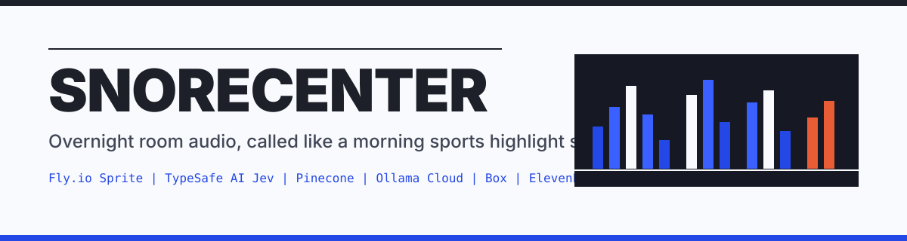

# SnoreCenter

**Your night, called like SportsCenter.**

SnoreCenter is a personal overnight room-audio broadcast agent running on a single **Fly.io Sprite** with zero raw API keys inside the container. Drop in an overnight audio tape (or test your room live for 8 seconds from the browser), and SnoreCenter slices acoustic peaks with local DSP, classifies them through **TypeSafe AI (Jev)**, checks recurring culprits across prior nights in **Pinecone**, writes dead-serious two-anchor sports commentary with **Ollama Cloud**, optionally voices the highlight reel via **ElevenLabs**, and archives a standalone **Breakfast Box Score** to **Box**.

> **Entertainment only:** SnoreCenter is built strictly for fun using ordinary room acoustics. Metrics such as *Longest Dramatic Pause* measure ordinary quiet stretches between detected room noises and are not a medical device or sleep-apnea assessment.

## Why a Fly.io Sprite?

A personal overnight audio agent is idle for 23 hours and 55 minutes a day, yet still needs persistent storage, local audio binaries (`ffmpeg` / `sox`), SQLite history, and authenticated access to external services without leaking raw credentials inside the agent runtime:

- **Sleep-to-zero, wake-on-HTTP:** Registered with `sprite-env services create --http-port 8080`, the Sprite stays at `$0` idle until you open the morning desk or drop a new recording.
- **Zero-key Sprites Connectors:** Every outbound call discovers its gateway dynamically from `GET https://api.sprites.dev/v1/gateway/list` and sends zero `Authorization` headers from Node. Verify live at `/connected` and `/connected?format=json`.
- **Persistent 100 GB ext4 + SQLite + Checkpoints:** Audio recordings, 32-dim FFT acoustic vectors, booth rulings, and nightly stats live in native `node:sqlite`, with copy-on-write snapshots via `sprite-env checkpoint create` and read-only inspection at `/.sprite/checkpoints/`.

## Sprites Connectors Used

| Connector | Role in SnoreCenter | Gateway Route |
| --- | --- | --- |
| **TypeSafe AI (Jev)** | Calibrated `choice` event classification, `score` drama rating, and `noul` highlight gate. Any event under `70%` confidence pauses for human booth review (`You call it`). | `POST /v1/decide` |
| **Pinecone** | Stores and queries 32-dim unit-normalized FFT acoustic signatures across nights so recurring culprits (like Tuesday's 142 Hz hallway radiator) surface with cosine scores. | `POST /query`, `POST /vectors/upsert` |
| **Ollama Cloud** | Synthesizes grounded two-anchor morning play-by-play (Rex Vance & Margo Hale) strictly citing real DSP timestamps, dB peaks, dominant frequencies, and vector matches. | `POST /v1/chat/completions` |
| **Box** | Archives standalone print-clean Breakfast Box Score HTML cards to `/Highlights` (and supports overnight tape drops in `/NightWatch`). | `GET /2.0/folders/0/items`, `POST /2.0/files/content` |
| **ElevenLabs** | Voices the morning highlight reel when attached to the Sprite. | `POST /v1/text-to-speech/{voice_id}` |

Outside a Sprite (local development or CI), SnoreCenter transparently reports `local-baseline` on `/connected` and runs real local PCM DSP, calibrated acoustic classification, SQLite cosine memory, and standalone HTML export with zero faked connection badges.

## Architecture

```text
Browser (Live 8s Mic WAV / File Upload / Replay Stage)
                |
                v
   Fly.io Sprite (Node 24, Zero Runtime Deps, Port 8080)
   ├── src/fft.mjs + src/dsp.mjs   -> Pure-JS Radix-2 FFT, STFT spectrogram, 32-dim vectors, ffmpeg fallback
   ├── src/db.mjs                  -> Native node:sqlite ledger + recurring acoustic signatures
   ├── src/connectors.mjs          -> Dynamic /v1/gateway/list discovery (0 raw API keys in env)
   │     ├── TypeSafe AI Jev       -> Calibrated confidence (<70% -> human "You call it" dialog)
   │     ├── Pinecone              -> Cross-night cosine matching + human-override upserts
   │     ├── Ollama Cloud          -> Grounded Rex Vance & Margo Hale play-by-play script
   │     ├── ElevenLabs            -> Optional voiced highlight audio
   │     └── Box                   -> Breakfast Box Score archive (/Highlights)
   └── /.sprite/checkpoints/       -> Read-only CoW snapshot history
```

## Quick Start (Local)

Requires **Node.js >= 22.5** (zero `npm install` needed — zero third-party runtime dependencies).

```bash
npm run generate-samples
npm test
npm start
```

Open `http://localhost:8080` to hear the seeded morning highlight tape, click any peak on the spectrogram, click **You call it** to issue a booth ruling, or click **Record 8s live** to test your own room microphone.

Check live connector discovery and environment key audit at `http://localhost:8080/connected`.

## Deploy to a Fly.io Sprite

1. Create a Sprite and attach your Connectors (**TypeSafe AI**, **Pinecone**, **Ollama**, **Box**, and optionally **ElevenLabs**) in the Fly.io Sprites dashboard.
2. Push this repository onto the Sprite (for example `/home/sprite/snorecenter`).
3. Run the provisioning script inside the Sprite:

```bash
bash scripts/setup-sprite.sh /home/sprite/snorecenter
```

4. Expose the wake-on-HTTP URL:

```bash
sprite config update --url-auth public
```

5. Open `https://<your-sprite>.sprites.app/connected` to confirm `rawApiKeysInEnv: 0` and active Sprite Gateways.

## API Endpoints

- `GET /healthz` — runtime health, uptime, audio binary availability (`ffmpeg`/`sox`), and connector summary.
- `GET /connected` (`?format=json`) — live Sprites Gateway discovery and zero-key environment audit.
- `GET /api/state` — active morning broadcast session, nightly history, season highs, and checkpoints.
- `POST /api/analyze/sample` — re-runs DSP + Connector pipeline on the overnight WAV sample.
- `POST /api/analyze/upload` — ingests live browser PCM WAV recordings or uploaded audio files.
- `POST /api/events/:id/recall` — records a human booth ruling, upserts the corrected 32-dim vector into Pinecone + SQLite, and refreshes commentary.
- `POST /api/sessions/:id/archive-box` — exports and uploads the Breakfast Box Score HTML card to Box.
- `POST /api/checkpoints` — creates a CoW Sprite checkpoint (`sprite-env checkpoint create`) or local SQLite snapshot.

## Credits & Licenses

- **Barlow Condensed & Barlow** fonts by Jeremy Tribby — [SIL Open Font License 1.1](https://github.com/jpt/barlow) (self-hosted in `public/fonts/`).
- **JetBrains Mono** font by JetBrains — [SIL Open Font License 1.1](https://github.com/JetBrains/JetBrainsMono) (self-hosted in `public/fonts/`).
- Built on Node.js built-in modules (`node:http`, `node:sqlite`, `node:test`) with zero third-party npm runtime dependencies.
- Licensed under the [MIT License](LICENSE).
